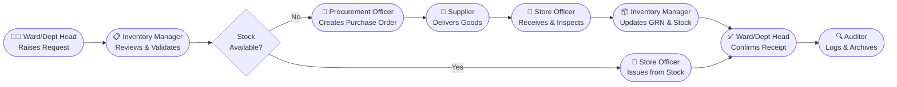

# Requisition Flow — From Request to Receipt Confirmation
### Federal Medical Centre (FMC) Abuja — Inventory Management System

> **How to use this document:** Each section below maps a stage of the requisition lifecycle to the role(s) responsible.  
> Below each section heading is a **🎞️ Slideshow Prompt** — paste it into an AI presentation generator (e.g., Gamma, Beautiful.ai, Tome, or ChatGPT Slides) to instantly create a slide deck for that stage.

---

## Requisition Lifecycle — Overview



---

## Stage 1 — Raising the Requisition Request

> **Roles:** `Ward/Dept Head` · `Pharmacist` · `Biomedical Engineer`

### 🎞️ Slideshow Prompt — Stage 1
```
Create a professional 6-slide presentation for a hospital inventory system titled:
"Stage 1: Raising a Requisition Request"

Audience: Hospital department heads, pharmacists, and biomedical engineers at a tertiary hospital (Federal Medical Centre Abuja).
Tone: Clear, instructional, professional.
Design: Clean medical/healthcare theme, blue and white color palette.

Slides:
1. Title Slide — "Stage 1: Raising a Requisition Request" with subtitle "Who: Ward/Dept Head · Pharmacist · Biomedical Engineer"
2. What is a Requisition? — Define a requisition in the hospital context: a formal internal request for items (drugs, consumables, equipment) needed by a department or ward.
3. Who Can Raise a Request? — List roles with icons:
   - Ward/Dept Head: requests consumables, PPE, ward supplies
   - Pharmacist: requests drugs, pharmaceutical supplies
   - Biomedical Engineer: requests spare parts, medical equipment
4. Types of Requisitions — Three types with short description:
   - Internal Requisition (from existing stock)
   - Departmental Requisition (inter-department transfer)
   - Purchase Requisition (new procurement from supplier)
5. How to Submit a Request — Step-by-step: Login → Requisitions → New → Select Type → Add Items & Quantities → Add Justification Note → Submit
6. Key Rules & Tips — Minimum required fields, how to choose the correct type, what happens after submission (notification to Inventory Manager)
```

---

## Stage 2 — Review & Validation

> **Roles:** `Inventory Manager`

### 🎞️ Slideshow Prompt — Stage 2
```
Create a professional 6-slide presentation for a hospital inventory system titled:
"Stage 2: Review & Validation of Requisitions"

Audience: Inventory managers and store supervisors at Federal Medical Centre Abuja.
Tone: Authoritative, process-focused, professional.
Design: Clean, modern healthcare theme with green accent (approval/validation).

Slides:
1. Title Slide — "Stage 2: Review & Validation" with subtitle "Who: Inventory Manager"
2. The Inventory Manager's Role — Brief description: gatekeeper of stock accuracy, responsible for validating all incoming requisitions before any item movement occurs.
3. What Gets Checked? — Checklist visual:
   - ✅ Item exists in the product catalog
   - ✅ Requested quantity is reasonable
   - ✅ Requesting department is authorized
   - ✅ Requisition type matches the need
   - ✅ Budget/cost center is assigned (if applicable)
4. Stock Check Decision — Flowchart description: If stock is sufficient → approve for internal issue; if stock is insufficient → escalate to Procurement Officer for a purchase order.
5. Approve or Reject — How to approve (single click, adds comment), how to reject (must provide rejection reason), how the requester is notified in either case.
6. Audit Trail — All validation actions are logged (timestamp, user, action) ensuring full traceability. Mention the Auditor's visibility into this log.
```

---

## Stage 3 — Stock Check & Internal Issuance

> **Roles:** `Store Officer` · `Inventory Manager`

### 🎞️ Slideshow Prompt — Stage 3
```
Create a professional 7-slide presentation for a hospital inventory system titled:
"Stage 3: Stock Check & Internal Issuance"

Audience: Store officers and inventory managers at a tertiary hospital.
Tone: Practical, step-by-step, professional.
Design: Warehouse/stock room theme, orange and white color palette.

Slides:
1. Title Slide — "Stage 3: Stock Check & Internal Issuance" with subtitle "Who: Store Officer · Inventory Manager"
2. What Triggers This Stage? — A validated and approved internal or departmental requisition lands in the Store Officer's queue.
3. The Store Officer's Responsibilities — Physical stock check, confirming bin/shelf location, verifying batch numbers and expiry dates, picking and packaging the requested items.
4. Checking Stock Levels in the System — Show how to navigate to Stock & Inventory module, search by SKU or product name, view available quantity, reserved quantity, and location.
5. Issuing the Items — Step-by-step: Open approved requisition → Confirm quantities → Select batch/lot → Click "Issue" → System deducts stock automatically.
6. Partial Issuance — What happens when only part of the requested quantity is available: partial issue recorded, remaining quantity triggers a back-order or purchase request.
7. Handover to Department — Generating the issue slip, obtaining the requester's acknowledgment signature (digital or physical), completing the transaction.
```

---

## Stage 4 — Procurement & Purchase Order Creation

> **Roles:** `Procurement Officer` · `Inventory Manager`

### 🎞️ Slideshow Prompt — Stage 4
```
Create a professional 8-slide presentation for a hospital inventory system titled:
"Stage 4: Procurement & Purchase Order Creation"

Audience: Procurement officers and inventory managers at Federal Medical Centre Abuja.
Tone: Formal, compliance-focused, professional.
Design: Corporate blue theme with document/contract imagery.

Slides:
1. Title Slide — "Stage 4: Procurement & Purchase Order Creation" with subtitle "Who: Procurement Officer · Inventory Manager"
2. When is Procurement Triggered? — When stock is insufficient to fulfill an approved requisition, the system escalates to the Procurement Officer automatically.
3. The Procurement Officer's Role — Overview: sourcing suppliers, negotiating prices, raising purchase orders (POs), ensuring compliance with hospital procurement policy.
4. Reviewing the Escalated Requisition — How to view escalated items, link them to existing supplier contracts, and check historical pricing.
5. Creating a Purchase Order — Step-by-step: Go to Procurement → New PO → Link requisition → Select supplier → Add unit prices → Set expected delivery date → Submit for authorization.
6. Authorization Levels — Describe approval tiers (e.g., POs under ₦500,000 approved by Inventory Manager; above ₦500,000 requires Admin/Director approval).
7. Sending PO to Supplier — How the system sends or exports the PO (PDF/email), what the supplier confirmation looks like, and how to track PO status.
8. Compliance & Documentation — Why every PO must be traceable to a requisition, audit requirements, and how the system enforces this linkage.
```

---

## Stage 5 — Goods Receipt & Inspection

> **Roles:** `Store Officer` · `Procurement Officer`

### 🎞️ Slideshow Prompt — Stage 5
```
Create a professional 7-slide presentation for a hospital inventory system titled:
"Stage 5: Goods Receipt & Inspection"

Audience: Store officers and procurement officers at a tertiary hospital.
Tone: Practical, quality-focused, professional.
Design: Receiving dock / warehouse theme, teal and white color palette.

Slides:
1. Title Slide — "Stage 5: Goods Receipt & Inspection" with subtitle "Who: Store Officer · Procurement Officer"
2. What Triggers This Stage? — Supplier delivers goods against an approved purchase order. The Store Officer is notified to receive and inspect.
3. Physical Inspection Checklist — Visual checklist:
   - ✅ Delivery matches PO (item, quantity, brand)
   - ✅ Packaging is intact
   - ✅ Batch numbers match invoice
   - ✅ Expiry dates are acceptable (minimum shelf life policy)
   - ✅ Temperature-sensitive items stored correctly
4. Creating a Goods Received Note (GRN) — Step-by-step: GRN Module → Create → Select PO → Enter received quantities → Add batch & expiry info → Attach supplier invoice → Save.
5. Discrepancy Handling — What to do when quantities are short, items are damaged, or expiry is non-compliant: partial GRN, rejection notes, and notifying the Procurement Officer.
6. Stock Update — How saving the GRN automatically updates stock levels in real time: quantity on hand increases, status changes from "pending" to "in stock".
7. Document Filing — Retaining the GRN, delivery note, and supplier invoice for audit and future reference. Role of the Auditor in reviewing GRN accuracy.
```

---

## Stage 6 — Confirmation of Receipt

> **Roles:** `Ward/Dept Head` · `Pharmacist` · `Biomedical Engineer`

### 🎞️ Slideshow Prompt — Stage 6
```
Create a professional 6-slide presentation for a hospital inventory system titled:
"Stage 6: Confirmation of Receipt"

Audience: Ward heads, pharmacists, and biomedical engineers who are end-recipients of requisitioned items.
Tone: Simple, end-user friendly, professional.
Design: Clean, green "completion" theme with checkmarks and success visuals.

Slides:
1. Title Slide — "Stage 6: Confirmation of Receipt" with subtitle "Who: Ward/Dept Head · Pharmacist · Biomedical Engineer"
2. Why Confirmation Matters — Closes the requisition loop, confirms accountability, prevents disputes, and serves as proof of delivery for audit purposes.
3. What Needs to be Confirmed? — Items received, quantities correct, condition acceptable, delivered to the right location/ward.
4. How to Confirm in the System — Step-by-step: Login → My Requisitions → Find fulfilled requisition → Click "Confirm Receipt" → Enter received quantity → Add notes (if any) → Submit.
5. Discrepancy at Receipt — If items received don't match what was issued: how to flag a discrepancy, who gets notified (Store Officer + Inventory Manager), and what happens next.
6. Requisition Closed — Once confirmed, the requisition status changes to "Completed". The Auditor is notified. The full transaction history is locked for the record.
```

---

## Stage 7 — Audit & Archiving

> **Roles:** `Auditor` · `Super Admin`

### 🎞️ Slideshow Prompt — Stage 7
```
Create a professional 6-slide presentation for a hospital inventory system titled:
"Stage 7: Audit Trail & Archiving"

Audience: Auditors, compliance officers, and system administrators at Federal Medical Centre Abuja.
Tone: Formal, compliance-driven, professional.
Design: Dark navy / gold theme reflecting authority and record-keeping.

Slides:
1. Title Slide — "Stage 7: Audit Trail & Archiving" with subtitle "Who: Auditor · Super Admin"
2. The Auditor's Role — Passive throughout the workflow but has read-only visibility into every stage. After completion, the Auditor performs formal review of the entire requisition record.
3. What the Audit Log Contains — For every action: timestamp, user, role, action performed, item affected, quantity, and before/after values.
4. Reviewing a Completed Requisition — How to navigate to the Audit module, filter by date range / department / item / user, and export the log to Excel or PDF.
5. Compliance Checks — What the Auditor looks for: unauthorized actions, skipped steps, quantity mismatches between GRN and confirmed receipt, policy violations.
6. Archiving & Retention — How completed requisitions are archived (read-only), retention policy (e.g., 7 years for hospital records), and how Super Admin manages archive storage.
```

---

## Role Summary Matrix

| Stage | Action | Ward/Dept Head | Pharmacist | Biomedical Eng. | Inventory Manager | Procurement Officer | Store Officer | Auditor | Super Admin |
|-------|--------|:--------------:|:----------:|:---------------:|:-----------------:|:-------------------:|:-------------:|:-------:|:-----------:|
| 1 | Raise Requisition | ✅ | ✅ | ✅ | | | | | |
| 2 | Review & Validate | | | | ✅ | | | 👁️ | |
| 3 | Issue from Stock | | | | ✅ | | ✅ | 👁️ | |
| 4 | Create Purchase Order | | | | ✅ | ✅ | | 👁️ | ✅ |
| 5 | Receive & Inspect Goods | | | | | ✅ | ✅ | 👁️ | |
| 6 | Confirm Receipt | ✅ | ✅ | ✅ | | | | 👁️ | |
| 7 | Audit & Archive | | | | | | | ✅ | ✅ |

> **Legend:** ✅ = Can Perform · 👁️ = Read-Only Visibility

---

## 🎞️ Full Overview Slideshow Prompt
```
Create a professional 10-slide executive overview presentation titled:
"Requisition Lifecycle — From Request to Receipt"
Subtitle: "Federal Medical Centre Abuja — Inventory Management System"

Audience: Hospital directors, department heads, and IT administrators.
Tone: Executive summary, high-level, authoritative.
Design: Premium medical/healthcare theme, deep blue and gold color palette.

Slides:
1. Title Slide — Full title and subtitle with FMC Abuja branding.
2. Why a Structured Requisition Process? — Problems solved: unauthorized stock release, untraceable consumption, procurement fraud, stockouts and overstocking.
3. The 8 Roles in the System — Grid with icons for each role: Super Admin, Inventory Manager, Procurement Officer, Pharmacist, Ward/Dept Head, Store Officer, Biomedical Engineer, Auditor.
4. Lifecycle Overview — Visual flowchart of all 7 stages end-to-end.
5. Stage 1–2: Request & Validation — Who raises requests, what the Inventory Manager checks.
6. Stage 3: Internal Issuance — Stock availability, picking, and issue slip.
7. Stage 4–5: Procurement & Receiving — Purchase order creation, supplier delivery, GRN.
8. Stage 6: Receipt Confirmation — Closing the loop with the requesting department.
9. Stage 7: Audit & Compliance — Full traceability, log export, archiving.
10. Key Benefits — Real-time stock accuracy, accountability at every stage, audit-ready records, reduced waste and pilferage.
```

---

*Generated for: Federal Medical Centre Abuja — Inventory Management System*  
*Document version: 1.0 | Date: September 2026*
